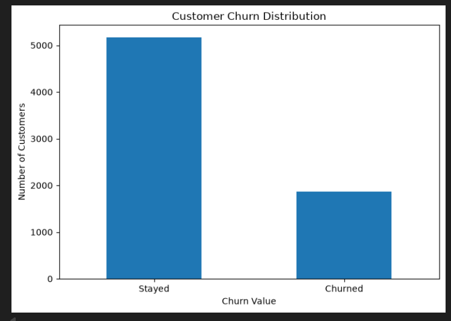
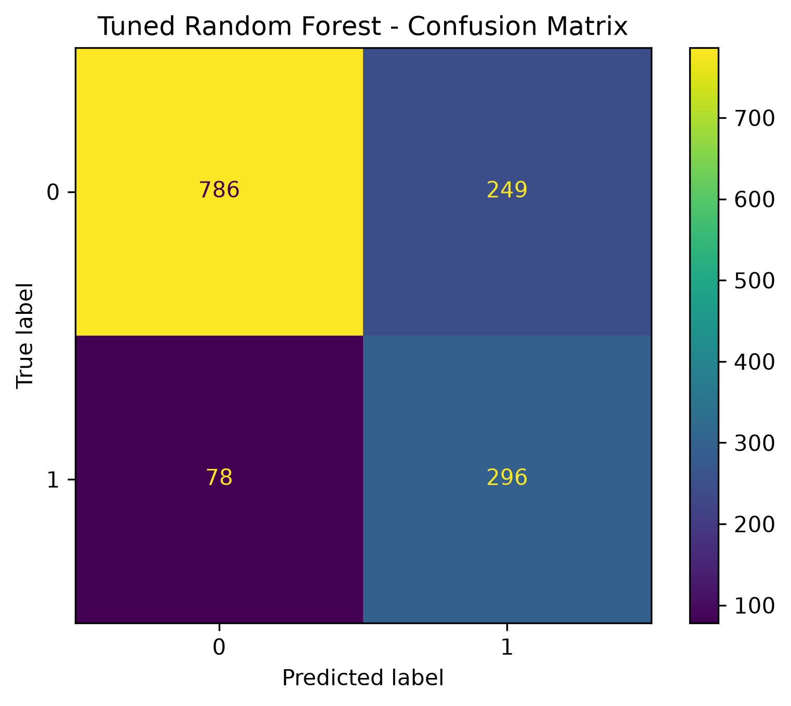

# Customer Churn Prediction using Machine Learning

A Machine Learning project that predicts whether a customer is likely to churn based on customer demographics, services, contract information, billing details, and customer lifetime value.

This project covers the complete Machine Learning workflow, from data analysis and preprocessing to model training, evaluation, hyperparameter tuning, threshold analysis, and model saving.

---

## Project Overview

Customer churn occurs when a customer stops using a company's product or service.

The objective of this project is to build a Machine Learning classification model that can identify customers who are likely to churn.

The prediction can help businesses identify customers at risk of leaving and support customer retention strategies.

---

## Problem Statement

Given customer information, predict whether the customer will:

- `0` → Stay
- `1` → Churn

This is a Binary Classification problem.

---

## Dataset

The project uses the **Telco Customer Churn Dataset**, originally provided as an IBM sample dataset and also available through Kaggle.

### Dataset

[Telco Customer Churn Dataset on Kaggle](https://www.kaggle.com/datasets/blastchar/telco-customer-churn)

The dataset contains:

- 7,043 customers
- 21 columns
- Customer demographic information
- Service information
- Contract information
- Billing information
- Customer churn information

### Target Variable

`Churn Value`

Where:

- `0` = Customer stayed
- `1` = Customer churned

---

## Machine Learning Workflow

```text
Dataset
   ↓
Data Understanding
   ↓
Exploratory Data Analysis
   ↓
Data Cleaning
   ↓
Feature Selection
   ↓
Data Preprocessing
   ↓
Train/Test Split
   ↓
Model Training
   ↓
Model Evaluation
   ↓
Hyperparameter Tuning
   ↓
Probability Threshold Analysis
   ↓
Model Saving
   ↓
Prediction System
```

---

## Exploratory Data Analysis

The following relationships were analyzed during EDA:

- Churn distribution
- Contract type vs churn
- Tenure vs churn
- Monthly charges vs churn
- Internet service vs churn
- Tech support vs churn
- Online security vs churn
- Payment method vs churn
- Senior citizen vs churn
- Numerical feature relationships
- Correlation matrix

### Churn Distribution

The dataset contains:

- 5,174 customers who stayed
- 1,869 customers who churned

The observed churn rate is approximately 26.5%.



---

## Data Cleaning

The following data-cleaning operations were performed:

- Missing value analysis
- Data type validation
- Duplicate row checking
- Duplicate Customer ID checking
- Numerical value validation
- Missing `Total Charges` investigation

### Missing Total Charges

There were 11 missing values in `Total Charges`.

After investigation, these customers had:

```text
Tenure Months = 0
```

Therefore, their `Total Charges` values were replaced with:

```text
0
```

### Duplicate Check

```text
Duplicate Rows       = 0
Duplicate CustomerID = 0
```

---

## Feature Selection

The following features were selected for the Machine Learning model:

```text
Gender
Senior Citizen
Partner
Dependents
Tenure Months
Phone Service
Multiple Lines
Internet Service
Online Security
Online Backup
Device Protection
Tech Support
Streaming TV
Streaming Movies
Contract
Paperless Billing
Payment Method
Monthly Charges
Total Charges
CLTV
```

---

## Data Leakage Prevention

Some columns were removed because they could introduce data leakage or were not useful as predictive features.

Removed columns include:

```text
CustomerID
Count
Country
State
City
Zip Code
Lat Long
Latitude
Longitude
Churn Label
Churn Score
Churn Reason
```

### Why remove Churn Label?

`Churn Label` directly represents the churn outcome.

### Why remove Churn Score?

`Churn Score` is already a churn-related score and may contain information derived from the churn outcome.

### Why remove Churn Reason?

`Churn Reason` describes why a customer already churned. Using it as an input would provide information that would not be available when predicting whether a customer will churn.

---

## Data Preprocessing

The dataset contains both numerical and categorical features.

### Numerical Features

Numerical features were standardized using:

`StandardScaler`

### Categorical Features

Categorical features were converted into numerical representations using:

`OneHotEncoder`

The preprocessing process was implemented using:

`ColumnTransformer`

Unknown categories were handled using:

```python
handle_unknown="ignore"
```

---

## Train/Test Split

The dataset was divided into:

```text
80% → Training Data
20% → Testing Data
```

Stratified splitting was used to maintain a similar churn distribution between the training and testing datasets.

---

## Machine Learning Models

Three classification models were initially trained:

### 1. Logistic Regression

Used as the baseline classification model.

### 2. Random Forest

An ensemble of decision trees capable of learning nonlinear relationships between features.

### 3. Gradient Boosting

An ensemble learning technique that builds models sequentially to improve predictive performance.

---

## Model Evaluation

The models were evaluated using:

- Accuracy
- Precision
- Recall
- F1 Score
- ROC-AUC
- Confusion Matrix

### Baseline Results

| Model | Accuracy | Precision | Recall | F1 Score | ROC-AUC |
|---|---:|---:|---:|---:|---:|
| Logistic Regression | 74.24% | 50.96% | 78.34% | 61.75% | 84.90% |
| Random Forest | 78.00% | 56.87% | 70.86% | 63.10% | 84.58% |
| Gradient Boosting | 79.91% | 65.32% | 51.87% | 57.82% | 85.09% |

These are the baseline results obtained before the final model-tuning stage.

---

## Confusion Matrix

Confusion matrices were used to understand the prediction errors made by the models.

They show:

- True Positives
- True Negatives
- False Positives
- False Negatives



---

## Hyperparameter Tuning

Random Forest was further optimized using `GridSearchCV`.

The following parameters were explored:

```text
n_estimators
max_depth
min_samples_split
min_samples_leaf
```

Five-fold cross-validation was used during hyperparameter tuning.

The tuned Random Forest was then evaluated on the unseen test dataset.

---

## Probability Threshold Analysis

The trained model produces a probability of churn rather than only a binary prediction.

For example:

```text
Churn Probability = 0.73
```

Different probability thresholds were tested to analyze the trade-off between:

- Precision
- Recall
- F1 Score

Among the tested thresholds, the best F1 score was obtained at:

```text
Threshold = 0.50
Precision = 54.31%
Recall    = 79.14%
F1 Score  = 64.42%
```

The selected threshold was saved as part of the model configuration.

---

## Model Saving

The trained model and preprocessing components were saved using `joblib`.

```text
models/
│
├── churn_model.pkl
├── preprocessor.pkl
└── model_config.pkl
```

### churn_model.pkl

Contains the trained Random Forest model.

### preprocessor.pkl

Contains the preprocessing pipeline used to transform new customer data.

### model_config.pkl

Contains:

- Selected features
- Prediction threshold

---

## Prediction System

The project includes a reusable prediction script:

```text
src/predict.py
```

The script loads the saved model, preprocessor, and configuration and can make predictions for new customers.

Example output:

```text
Customer Churn Prediction
-----------------------------------
Churn Probability: 73.20%
Prediction: Likely to Churn
Risk Level: High
Threshold: 0.50
```

---

## Project Structure

```text
customer-churn-prediction/
│
├── data/
│   └── customer_churn.xlsx
│
├── notebooks/
│   └── customer_churn_prediction.ipynb
│
├── models/
│   ├── churn_model.pkl
│   ├── preprocessor.pkl
│   └── model_config.pkl
│
├── src/
│   └── predict.py
│
├── images/
│   ├── churn_distribution.png
│   ├── correlation_matrix.png
│   ├── confusion_matrix.png
│   └── model_comparison.png
│
└── README.md
```

---

## Technologies Used

### Programming Language

- Python

### Data Analysis

- Pandas
- NumPy

### Data Visualization

- Matplotlib
- Seaborn

### Machine Learning

- Scikit-learn

## Learning Outcomes

Through this project, I learned:

- Complete Machine Learning project workflow
- Exploratory Data Analysis (EDA)
- Data cleaning and missing value handling
- Feature selection and leakage prevention
- Categorical and numerical preprocessing
- Train-test splitting with stratification
- Logistic Regression, Random Forest, and Gradient Boosting
- Model evaluation using Accuracy, Precision, Recall, F1 Score, and ROC-AUC
- Hyperparameter tuning using GridSearchCV
- Probability threshold optimization
- Model serialization using Joblib
- Building a reusable prediction system
- Structuring an ML project for GitHub

---

## Author

**AYUSH ANAND**

B.Tech – Artificial Intelligence & Machine Learning

---

## Project Purpose

This project was developed as a practical Machine Learning project to understand the complete lifecycle of a customer churn prediction system, from raw data analysis to model training, evaluation, optimization, and deployment-ready prediction.